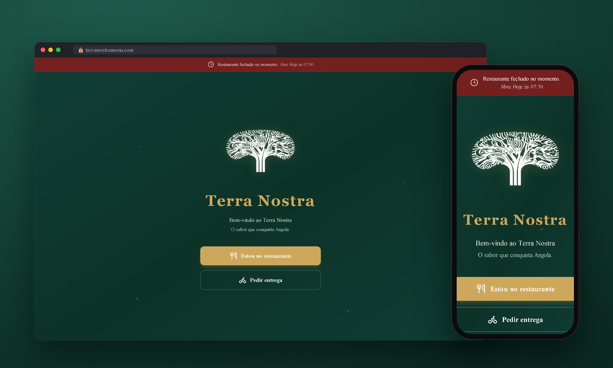
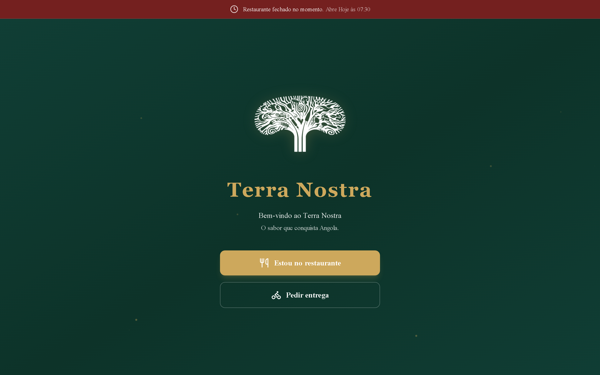
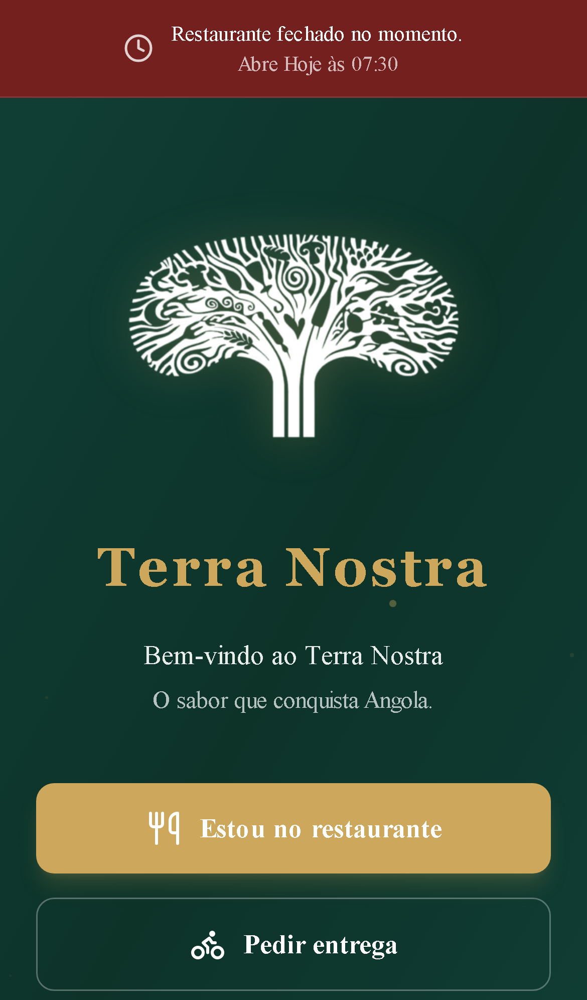
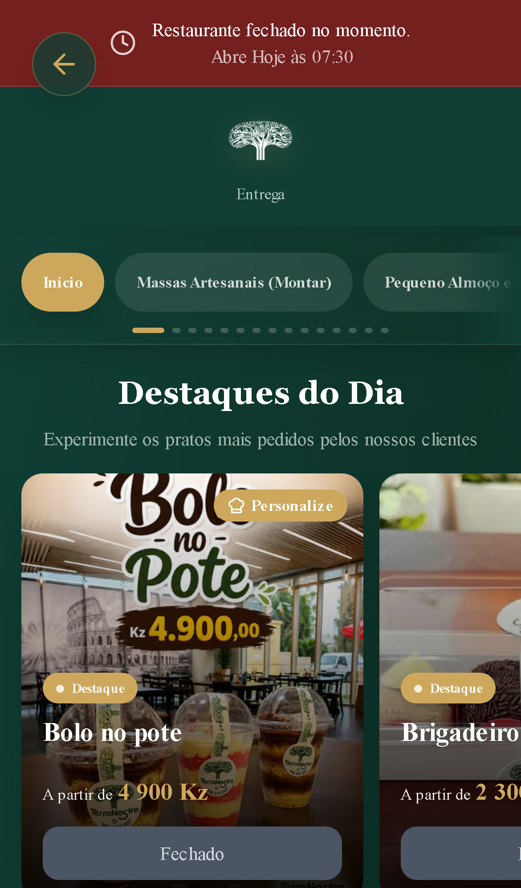

# Terra Nostra · Ordering Platform

Digital ordering platform for Terra Nostra, a restaurant in Luanda, Angola.

 

## Highlights

- **Two ordering flows:** QR code ordering at the table, and delivery.
- **Real-time kitchen:** orders reach the kitchen the moment they are placed.
- **Owner dashboard:** sales and revenue analytics.
- **Opening hours aware:** the app tells customers when the restaurant is closed and when it opens.
- **Installable web app (PWA).**

## Screenshots

| Desktop | Mobile | Menu |
|---|---|---|
|  |  |  |

## Stack

    

## My role

Full-stack development: requirements, UI, front-end, back-end, deploy and support in production.

## Source code

The source code is private because it belongs to the client. I am happy to walk through the architecture and the code in an interview.

---

Built by **[Erick Rodrigues](https://github.com/Erickrodrigues05)**, Full-Stack Developer · erickrodrigues781@gmail.com
